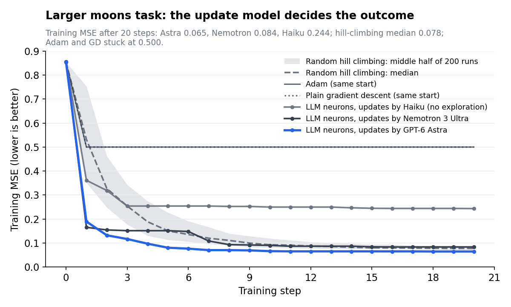

# LLMs as Neurons: run logs

Training logs from a small neural network where **every neuron is an LLM**. Each neuron
computes its own output from its inputs, weights, bias and activation, and decides for
itself how to change those parameters. It sees only the loss value, never gradients,
targets, the loss formula, or what the task is.

`logs/` holds one plain-text file per run: everything the run printed, in order. That
includes the loss at every step, each neuron's reasoning before every weight update, every
proposed change and whether it was kept, and the held-out test scores.

`prompts/` holds the exact prompts each run sent to the LLMs, one file per run: the
forward-pass prompt (computing a neuron's output) and the update prompt (choosing new
weights), with `{placeholders}` for the values filled in on every call.

`plots/` holds each run's loss curve and six comparison plots (see [Plots](#plots)).

## Run index

Every run starts from the same weights (seed 0). All results are **single runs**.
"Train MSE" is the loss at the end of the last step.

| Log | Task | Steps | Update model | What changed in this version | Train MSE | Test MSE / accuracy |
| --- | --- | --- | --- | --- | --- | --- |
| `run01_xor_first_version.log` | XOR | 10 | Haiku 5.5 | First version (20-token forward replies) | 0.515 | — |
| `run02_xor_answer_parser.log` | XOR | 10 | Haiku 5.5 | `ANSWER:` line, 300 tokens, one retry | 0.362 | — |
| `run03_xor_fixed_activation.log` | XOR | 20 | Haiku 5.5 | Activation as a fixed parameter; loss re-measured after each update | 0.281 | — |
| `run04_xor_high_thinking.log` | XOR | 20 | Haiku 5.5 | High thinking effort | 0.260 | — |
| `run05_xor_revert_history_cache.log` | XOR | 20 | Haiku 5.5 | Auto-revert, attempt history, forward cache | 0.222 | — |
| `run06_xor_influence.log` | XOR | 20 | Haiku 5.5 | Keep no-change updates; influence measurement | 0.149 | — |
| `run07_parity3_20_steps.log` | 3-bit parity | 20 | Haiku 5.5 | Tolerant parser, 1,000-token forward limit | 0.173 | — |
| `run08_parity3_40_steps.log` | 3-bit parity | 40 | Haiku 5.5 | Same, 40 steps | 0.132 | — |
| `run09_moons.log` | Moons (16 / 16 points) | 20 | Haiku 5.5 | Held-out test set | 0.090 | 0.133 / 81% |
| `run10_moons_big_haiku.log` | Moons, larger (40 / 40) | 20 | Haiku 5.5 | Bigger, noisier task | 0.244 | 0.326 / 55% |
| `run11_moons_big_nemotron.log` | Moons, larger (40 / 40) | 20 | Nemotron 3 Ultra | Forced exploration | 0.084 | 0.122 / 82.5% |
| `run12_moons_big_gpt6_astra.log` | Moons, larger (40 / 40) | 20 | GPT-6 Astra (low thinking) | Different update model | 0.065 | 0.124 / 77.5% |

The forward pass (the arithmetic) used Claude Haiku 5.5 in every run.

## Reading a log

Each log is split into sections named after the notebook sections they came from. The
training section uses these line formats:

| Line | Meaning |
| --- | --- |
| `step  4  MSE start=0.0974  end=0.0806 ...` | Loss before and after the step, plus parse, cache and exploration counters |
| `[L0N1 forward] in=[0.13, -1.01] act=relu -> 'ANSWER: 0.1634'` | One neuron's output for one input (from run 7 on, only the reply's last line is shown) |
| `[L1N0 update THINKING]` | The update model's reasoning before choosing new parameters |
| `[L1N0 update] loss=0.0767 -> {"weights": [...], "bias": ..., "activation": "..."}` | The proposed new parameters |
| `L0N3: {old} -> {new}  => loss 0.1896 -> 0.2047 (+0.0151)  REVERTED` | The change log entry; `REVERTED` means the change raised the loss and was undone |
| `[EXPLORE]` | A forced big move after two updates in a row that failed to lower the loss |
| `influence: {...}` | How far the final output moves when each hidden neuron's output is nudged by +0.5 (0 = ignored) |
| `>>> TEST (held out): MSE=...  accuracy=...` | Score on test points the neurons never see (moons runs only) |

Neuron names: `L0Nk` is hidden neuron k, `L1N0` is the output neuron.

Notes:

- In some runs an optional "keep training" cell ran part of an extra step before being
  stopped; that output appears in the log, so the final results section can differ
  slightly from the step-20 numbers above.
- In run 12 the reasoning text is a summary returned by the API, not the raw chain of thought.

## Plots

Comparison plots (hill-climbing curves are the median and middle half of 200 runs from
the same start; Adam and gradient descent also start from the same weights):

| Plot | What it shows |
| --- | --- |
| `compare_xor.png` | XOR: LLM neurons (run 06) vs hill climbing, Adam and gradient descent |
| `compare_parity3.png` | 3-bit parity: runs 07 and 08 vs the baselines over 40 steps |
| `compare_moons.png` | Moons: run 09 vs the baselines (training loss) |
| `compare_moons_big_update_models.png` | Larger moons task: Haiku, Nemotron 3 Ultra and GPT-6 Astra as update models vs the baselines |
| `xor_method_evolution.png` | Final XOR loss for each version of the method (runs 01–06) |
| `moons_big_matched_generalisation.png` | Test loss against training loss for 12,000 hill-climbing network states, with the Nemotron and Astra runs marked |

`plots/runNN_*_loss.png` is the loss curve each run plotted for itself.

## Prompts

Each `prompts/runNN_*.md` file matches the log of the same name. The prompts changed as the
method evolved; runs that share a prompt version:

| Runs | Prompt version |
| --- | --- |
| 01 | Neurons may combine inputs however they like; updates see only the loss and the other neurons' weights |
| 02 | Forward replies end with `ANSWER: <number>`; neurons may use non-linear functions |
| 03–04 | Fixed activation per neuron; updates see the loss change caused by each earlier update; bold moves encouraged |
| 05 | Updates told that loss-raising changes are undone; full attempt history added |
| 06 | Influence of each neuron added; no-change updates kept |
| 07–10 | Shorter forward working, stricter answer format, a strict retry prompt |
| 11–12 | Forced exploration added after two failed updates, with a re-ask when a proposal is too small |

## Baselines for comparison (same start, 20 steps)

| Task | Random hill climbing, median of 200 runs | Adam | Plain gradient descent |
| --- | --- | --- | --- |
| XOR | 0.187 | 0.500 (stuck) | 0.500 (stuck) |
| 3-bit parity | 0.174 | 0.197 | diverges |
| Moons | 0.068 (test 0.166 / 75%) | 0.056 (test 0.169 / 69%) | 0.059 (test 0.147 / 75%) |
| Moons, larger | 0.078 (test 0.133 / 80%) | 0.500 (stuck) | 0.500 (stuck) |

Gradient methods got stuck where the output neuron was a ReLU with negative input on every
example and a hidden neuron used `step`: every gradient was 0.
